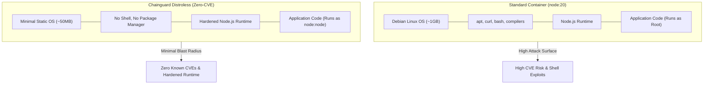

# Dockerize Node.js: Chainguard Secure Distroless vs Standard Containerization

<div align="center">

[](https://github.com/codewithmuh/dockerize-nodejs/releases)
[](https://opensource.org/licenses/MIT)
[](https://github.com/codewithmuh/dockerize-nodejs/stargazers)
[](https://github.com/codewithmuh/dockerize-nodejs/network/members)
[](https://nodejs.org/)
[](https://www.docker.com/)
[](https://www.chainguard.dev/)
[](https://youtu.be/7FGj4EwOX2E)

**Comprehensive guide to containerizing Node.js applications with zero known CVE vulnerabilities using Chainguard Distroless minimal images vs standard Debian/Alpine Docker images.**

[Comparison](#image-comparison) • [Architecture](#security-architecture) • [Quick Start](#setup-and-run) • [Chainguard Distroless Build](#approach-2-chainguard-secure-distroless-image) • [Security Best Practices](#production-security-best-practices)

</div>

---


## Overview

In modern cloud-native environments, running standard base container images introduces hundreds of unneeded OS packages, package managers (`apt`, `apk`), shells (`bash`, `sh`), and Common Vulnerabilities and Exposures (CVEs). 

This repository provides a direct hands-on comparison between:
1. **Standard `node:20` Image:** Familiar, all-inclusive image suitable for development.
2. **Chainguard `cgr.dev/chainguard/node:latest` Distroless Image:** Minimal, secure, zero-CVE image purpose-built for production environments without unnecessary attack surface.

🎥 **Watch the complete step-by-step video breakdown on [YouTube](https://youtu.be/7FGj4EwOX2E).**

---

## Image Comparison

| Metric | Standard `node:20` | Chainguard Distroless |
|---|:---:|:---:|
| **Base OS** | Debian Linux | Minimal Chainguard / Wolfi |
| **Image Size** | ~1.1 GB | **~150 MB (~85% smaller)** |
| **Vulnerability Count (CVEs)** | 50+ (High/Medium/Low) | **0 known CVEs** |
| **Shell Included (`bash`/`sh`)** | Yes (Expanded attack vector) | **No (Distroless)** |
| **Package Manager Included** | `apt-get` / `dpkg` | **None** |
| **User Context** | Default `root` (Unless configured) | Non-root `node:node` enforced |
| **Recommended Environment** | Local Development & Debugging | **Production Cloud & Kubernetes** |

---

## Security Architecture



---

## Project Structure

- [`server.js`](server.js): Minimal HTTP server listening on port `3000` and serving [`index.html`](index.html).
- [`Dockerfile`](Dockerfile): Standard Node.js 20 multi-purpose Dockerfile.
- [`Dockerfile-distroless`](Dockerfile-distroless): Chainguard secure minimal distroless Dockerfile.
- [`.dockerignore`](.dockerignore): Excludes `node_modules` and local artifacts from build context.
- [`package.json`](package.json): Node project manifest and execution scripts.

---

## Setup and Run

### Prerequisites

- [Node.js](https://nodejs.org/) (v18+) for running on host.
- [Docker](https://www.docker.com/) installed and running.

---

### Local Execution (Without Docker)

```bash
git clone https://github.com/codewithmuh/dockerize-nodejs.git
cd dockerize-nodejs

npm install
npm start
```
Visit `http://localhost:3000` to preview the web server.

---

### Approach 1: Standard `node:20` Image

Build and run using the standard image:

```bash
# Build the container image
docker build -t node-server:standard .

# Run the container (maps port 3000)
docker run -it --rm -p 3000:3000 node-server:standard
```

---

### Approach 2: Chainguard Secure Distroless Image

Build and run using the production-ready Chainguard distroless container:

```bash
# Build using the distroless definition
docker build -f Dockerfile-distroless -t node-server:chainguard .

# Run the hardened container
docker run -it --rm -p 3000:3000 node-server:chainguard
```

Open `http://localhost:3000` in your browser.

---

## Production Security Best Practices

1. **Non-Root Execution:** Always run Node.js as an unprivileged user (e.g., `COPY --chown=node:node`).
2. **Exclude Package Managers:** Never ship `npm`, `yarn`, or OS package managers into production images.
3. **Remove Interactive Shells:** Distroless images remove `bash` and `sh`, eliminating arbitrary remote code execution via shell injection.
4. **Sign Images with Cosign:** Chainguard images ship with built-in Software Bill of Materials (SBOM) and Sigstore Cosign signatures.
5. **Continuous Vulnerability Scanning:** Scan images using Trivy, Grype, or Docker Scout inside CI/CD pipelines.

---

## Video Tutorial

Watch the complete walkthrough and vulnerability scanning demo on [YouTube: @codewithmuh](https://youtu.be/7FGj4EwOX2E).

---

## License

This project is licensed under the [MIT License](LICENSE).
